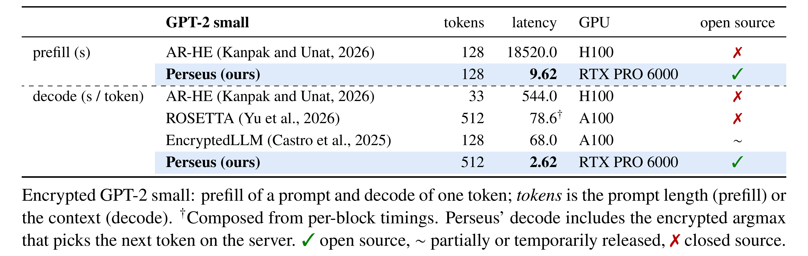
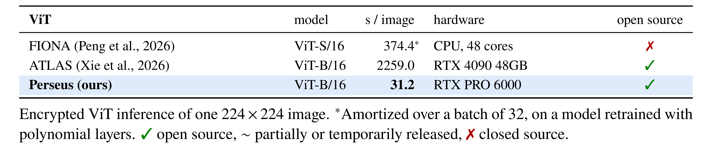
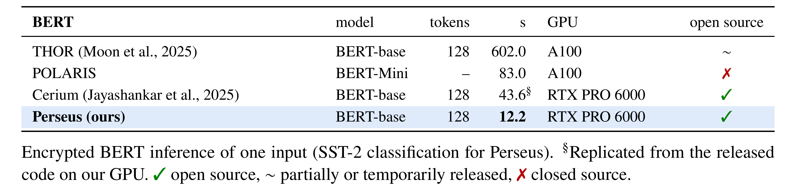

<p align="center">
  <a href="https://www.uniroma1.it/en"></a>
  &nbsp;&nbsp;&nbsp;&nbsp;&nbsp;&nbsp;&nbsp;&nbsp;&nbsp;&nbsp;
  <a href="https://www.gmu.edu"></a>
  &nbsp;&nbsp;&nbsp;&nbsp;&nbsp;&nbsp;&nbsp;&nbsp;&nbsp;&nbsp;
  <picture>
    <source media="(prefers-color-scheme: dark)" srcset="assets/paradigma-symbol-white.svg">
    <source media="(prefers-color-scheme: light)" srcset="assets/paradigma-symbol.svg">
    
  </picture>
</p>

<h1 align="center">Perseus</h1>

<p align="center"><b>An open Python framework for encrypted inference of large language models</b></p>

<p align="center">
  <a href="https://github.com/gladia-research-group/perseus/tree/speedrun">🏁 <b>Encrypted GPT-2 Speedrun</b></a>
</p>
<p align="center">
  <a href="#results">Results</a> ·
  <a href="#runtime">Runtime</a> ·
  <a href="#reproduce">Reproduce</a> ·
  <a href="#0-install">Install</a> ·
  <a href="#python-api">Python API</a> ·
  <a href="#citation">Citation</a>
</p>

Perseus runs transformers under fully homomorphic encryption on a single GPU, so the server computes
on data it never sees in the clear. Models, packings, nonlinear approximations and bootstrap
placement are plain Python; each block is compiled into a program that a Rust + CUDA CKKS runtime
replays (its kernels descend from [FIDESlib32bits](https://github.com/gladia-research-group/FIDESlib32bits),
our 32-bit GPU port of [FIDESlib](https://github.com/CAPS-UMU/FIDESlib)).

<p align="center">
  <a href="assets/paper-tables-overview-light.png">
    <picture>
      <source media="(prefers-color-scheme: dark)" srcset="assets/paper-tables-overview-dark.png">
      <source media="(prefers-color-scheme: light)" srcset="assets/paper-tables-overview-light.png">
      
    </picture>
  </a>
</p>

## What's inside

- **Python models, compiled.** GPT-2, Llama-3, BERT and ViT are Python programs on `perseus.impl`
  (`python/perseus/examples/`), with readable packings, nonlinearities and layers. Each block is recorded
  once on a CPU twin, compiled with its plan into a program, and replayed by the runtime with no Python on
  the critical path, from one device arena sized at setup.
- **In-kernel key regeneration.** Half of every key-switching key is regenerated on the GPU from a
  ChaCha12 seed instead of being stored.
- **Complex Cachemir packing.** Two real vectors per ciphertext, in the complex slots of CKKS.
- **Packing- and magnitude-aware bootstrap placement.** GPT-2 runs 416 bootstraps per token,
  against 584–894 for DaCapo, Orion and Fhelipe.

## Results

One NVIDIA RTX PRO 6000, 128-bit security. Prior results on their own hardware, or replicated on
ours where the code is released.

<p align="center">
  <a href="assets/paper-tables-llama-light.png">
    <picture>
      <source media="(prefers-color-scheme: dark)" srcset="assets/paper-tables-llama-dark.png">
      <source media="(prefers-color-scheme: light)" srcset="assets/paper-tables-llama-light.png">
      
    </picture>
  </a>
  <br>
  <a href="assets/paper-tables-gpt2-light.png">
    <picture>
      <source media="(prefers-color-scheme: dark)" srcset="assets/paper-tables-gpt2-dark.png">
      <source media="(prefers-color-scheme: light)" srcset="assets/paper-tables-gpt2-light.png">
      
    </picture>
  </a>
  <br>
  <a href="assets/paper-tables-vit-light.png">
    <picture>
      <source media="(prefers-color-scheme: dark)" srcset="assets/paper-tables-vit-dark.png">
      <source media="(prefers-color-scheme: light)" srcset="assets/paper-tables-vit-light.png">
      
    </picture>
  </a>
  <br>
  <a href="assets/paper-tables-bert-light.png">
    <picture>
      <source media="(prefers-color-scheme: dark)" srcset="assets/paper-tables-bert-dark.png">
      <source media="(prefers-color-scheme: light)" srcset="assets/paper-tables-bert-light.png">
      
    </picture>
  </a>
</p>

Times exclude key generation, encryption and decryption; each model runs its default plan
(`python/perseus/examples/defaults.py`).

## Runtime

`perseus-core` is the CKKS runtime in `crates/`, written in Rust and CUDA. The table times its
primitives on one RTX PRO 6000, and the two commands under it reproduce the table.

<p align="center">
  <a href="assets/paper-tables-core-light.png">
    <picture>
      <source media="(prefers-color-scheme: dark)" srcset="assets/paper-tables-core-dark.png">
      <source media="(prefers-color-scheme: light)" srcset="assets/paper-tables-core-light.png">
      
    </picture>
  </a>
</p>

```bash
cargo run --release -p pc-tools -F pc-gpu/mont --bin pc-bench -- modmul --k 1,8 --reps 20   # leaf operations
cargo run --release -p pc-tools --bin pc-bench -- bts --all --k 1,8 --reps 20 --keys packed  # bootstraps
```

## Reproduce

After the [install](#0-install), each script prints one row's time and its accuracy against the
float64 model (`NODE`/`MEMS` bind it to the GPU's NUMA node); each runs the model's default plan
(`python/perseus/examples/defaults.py`).

```bash
GPU=0 NODE=1 MEMS=1,2 bash scripts/repro/llama_prefill128.sh   # Llama-3-8B, 128-token prefill
GPU=0 bash scripts/repro/llama_decode.sh                        # Llama-3-8B, decode up to a 512-token context
GPU=0 bash scripts/repro/gpt2_decode_ctx.sh                     # GPT-2, decode up to a 512-token context
GPU=0 bash scripts/repro/gpt2_prefill128.sh                     # GPT-2, 128-token prefill to the first token
GPU=0 bash scripts/repro/bert_base.sh                           # BERT-base, 128 tokens (SST-2)
GPU=0 bash scripts/repro/vit_base.sh                            # ViT-B/16, four EuroSAT images
```

Llama-3-8B needs access to `meta-llama/Llama-3.1-8B`; Llama, BERT and ViT were measured on a 96 GB
GPU.

## Layout

- `crates/` the Rust + CUDA runtime
  - `pc-core` the CUDA-free CKKS mathematics (parameters, encoding, keys, bootstrap constants);
    `pc-shadow` the level/degree/scale engine the planner, the recorder and the runtime share;
    `pc-config` the typed run configuration.
  - `pc-cuda`, `pc-kernels`, `pc-cublas`, `pc-gpu` the device runtime (NTT, key switching,
    bootstrap routes, PCMM/CCMM, the plaintext store, one frozen device arena).
  - `pc-program` a recorded block + its plan -> a compiled program, and its replay.
  - `pc-py` the Python extension `perseus._pc`; `pc-client` the CUDA-free client (keys, encryption,
    the wire format); `pc-tools` benchmarks and cross-checks.
- `python/perseus/`
  - `impl/` the Python implementation of encrypted linear layers, attention, normalization and
    activations, the recorder and the planned drivers.
  - `plan/` the planner, which reads a recorded forward pass, simulates how levels are spent,
    places the bootstraps and picks each one's type. It also holds our ports of the DaCapo,
    Orion and Fhelipe planners.
  - `examples/{gpt2,llama,bert,vit}/` the four models on `perseus.impl`, with their runners
    and planning scripts (`make_plan.sh`); `defaults.py` the plan each runs by default.
  - `calibrate/`, `export.py`, `hub.py` the fitting of the polynomial approximations, the export
    of HuggingFace weights, the model download.
  - `client/`, `serve/` the client that holds the secret key and the server that runs on its key bundle.
  - `configs/model/approximation/` the fitted approximations of every model.
- `graphs/` the recorded forward passes the plans are computed from (the Llama ones ship as a
  release artifact, `graphs/RELEASE.txt`).
- `bootstrap_placements/` one directory per plan, each with the recipe that regenerates it and
  the runtime switches it was made for (`PLAN_CMD.txt`).
- `scripts/repro/` one script per result; `scripts/make_plans.sh` replays every plan's recipe;
  `scripts/utils/{dacapo,orion}_upstream/` run the released DaCapo and Orion tools.
- `notebooks/` a custom model on the runtime's operations and the client-server split.
- `tools/` the repo gate (`ci.sh`) and the route-table tool.
- `assets/` the logos and the paper's result tables (`paper-tables.tex`, `results-table.tex`, rendered by
  `render.sh`).

## Python API

`perseus.impl` is where models are written, as encrypted layers in Python. The recorder runs them
once on a CPU twin (no GPU and no values, only the op stream, the plaintexts and the levels), the
runtime compiles them per block with the plan, and the planned drivers replay them token after token.
`python/perseus/examples/gpt2` is GPT-2 written with it; its runner is the shortest way in.

```bash
source scripts/local_env.sh                     # the weights and the reference outputs (README step 1)
.venv/bin/python -m perseus.examples.gpt2.run_decode --tokens 4 --argmax          # the default plan
.venv/bin/python -m perseus.examples.gpt2.run_decode --fake --tokens 1 --argmax \
    --capture graphs/my_capture                                                  # record for the planner (CPU)
```

The runtime's operations are also callable one at a time, which is how a new model starts
(`notebooks/custom_encrypted_model.ipynb`).

```python
import numpy as np
from perseus import _pc

cfg = _pc.Config.preset("n32_gpt2_decode")             # the 32-bit chain
keys = _pc.KeySource.generate([1, 2, 4, 8], seed=0)     # secret key + the rotations the model uses
sess = _pc.Session(cfg, keys, pool=32, pt_slots=8).complete_setup()
fhe = sess.fhe
x = np.zeros(fhe.slots); x[:16] = np.random.default_rng(0).standard_normal(16)
y = fhe.rotate_and_sum(fhe.square(fhe.encrypt(x, 0)), 1, 16)   # sum of squares into slot 0
print(np.real(fhe.decrypt_slots_complex(y)[0]), np.sum(x ** 2))
sess.close()
```

A new model subclasses `perseus.impl.driver.ImplModel` and lists its stages, the masks each
step needs and its weights; `python/perseus/impl/__init__.py` describes the modules. The client
(`perseus.client`) and the server (`perseus.serve`) split the key holder from the GPU
(`notebooks/client_server.ipynb`).

## Pipeline

The complete sequence for GPT-2 on the 32-bit parameters, from the weights to an encrypted run.
Llama-3 follows the same steps with `python/perseus/examples/llama/make_plan.sh`. The BERT and ViT
plans ship ready to run. Every file a step produces is already in the repository, so any step can
be skipped.

### 0. Install

You need the following.
- Linux, an NVIDIA GPU of compute capability 12.0 (Blackwell; the kernels are built for `sm_120`)
  and CUDA 13.2 (`CUDA_HOME`, default `/usr/local/cuda-13.2`).
- A GPU with enough memory for the run. Decoding peaks at 59.1 GiB with GPT-2 and 48.2 GiB with
  Llama-3-8B, and the Llama-3-8B prefill needs the most, 86.3 GiB (the first table lists every peak,
  measured on a 96 GB GPU).
- The Rust toolchain (`rustup`; `rust-toolchain.toml` pins the version) and Python 3.12.

```bash
git clone https://github.com/gladia-research-group/perseus
cd perseus
uv venv --python 3.12 .venv && uv pip install --python .venv/bin/python -e ".[hf,examples,dev]"
.venv/bin/maturin develop --release              # builds the runtime and installs perseus._pc
```

The planner, the weight export and the approximation fitting run without the extension.
`scripts/local_env.sh` sets where the data lives, and a variable you export yourself always wins.

| variable | what it points at | default |
|---|---|---|
| `PERSEUS_DATA` | where the weights, the calibration text and the reference outputs live | `.cache/` |
| `WEIGHTS_PATH` | the exported weights (`weights.bin.zip`) | under `PERSEUS_DATA` |
| `ALL_BLOCKS_IO_DIR` | the reference outputs that encrypted runs are checked against | under `PERSEUS_DATA` |

The CKKS parameters and the runtime switches come from the plan (its `PLAN_CMD.txt`) and the
typed configuration (`perseus._pc.Config`).

### 1. Export the weights, fit the approximations, compute the reference outputs

```bash
.venv/bin/perseus-export --model openai-community/gpt2 --out .cache/models/openai-community/gpt2
.venv/bin/python -c 'import numpy as np; from omegaconf import OmegaConf; from perseus.calibrate import data; \
    np.save(".cache/pools/openwebtext_gpt2.npy", np.asarray(data.load_token_pool("openai-community/gpt2", \
    OmegaConf.load("python/perseus/configs/dataset/openwebtext.yaml"))))'
.venv/bin/perseus-calibrate model=gpt2 dataset=openwebtext
.venv/bin/python scripts/utils/gen_gpt2_oracle.py --model openai-community/gpt2 \
    --pool .cache/pools/openwebtext_gpt2.npy --out .cache/oracle/gpt2/all_blocks_io
```

The export packs the weights for the runtime. The calibration fits a polynomial approximation
to every nonlinear function (LayerNorm, softmax, GELU and the encrypted argmax) on the value
ranges it sees on OpenWebText; the shipped `gpt2_base_n32/configs.json` is the one the results
use. The last command runs the plaintext model on a fixed piece of text and saves its inputs
and output logits, the reference outputs that encrypted runs are compared against.

A model fine-tuned for encryption, such as the HEAT GPT-2, is exported on top of its base model
with `--checkpoint` (a `model.pt` file or a HuggingFace repository id).

```bash
.venv/bin/perseus-export --model openai-community/gpt2 \
    --checkpoint gladia/heat-gpt2-small-openwebtext --tag heat --out .cache/models/gladia/heat-gpt2
.venv/bin/python scripts/utils/gen_gpt2_oracle.py --model openai-community/gpt2 \
    --checkpoint gladia/heat-gpt2-small-openwebtext \
    --pool .cache/pools/openwebtext_gpt2.npy --out .cache/oracle/gpt2_heat/all_blocks_io
```

### 2. Record a forward pass

The planner reads a record of one encrypted forward pass, with every encrypted value, how its data
is laid out and the largest magnitude it reaches. The first token runs without a plan on the
CPU twin (the numpy model of the runtime, values included) and is recorded block by block, the
encrypted argmax included.

```bash
source scripts/local_env.sh
.venv/bin/python -m perseus.examples.gpt2.run_decode --fake --tokens 1 --argmax \
    --capture graphs/gpt2_decode
```

A recording belongs to one approximation config and one set of runtime switches, and changing either
means recording again.

### 3. Plan

The planner runs on the CPU, in seconds per plan (the comparison tools take minutes). Each plan
directory's `PLAN_CMD.txt` holds its recipe, and `make_plans.sh` replays them.

```bash
bash scripts/make_plans.sh gpt2_decode                # the GPT-2 decode plan
bash scripts/make_plans.sh                            # every plan in the repository
```

`python -m perseus.plan --help` lists the planner's options, among them the safety margin on
recorded magnitudes (`--mag-safety`), the accuracy target (`--err-target`), the largest scaling
setting (`--cf-max`), the sizes of the cheaper bootstrap (`--sparse-slots`), removing bootstraps
that turn out redundant (`--prune`) and the placement algorithm
(`--placer {min_cut,ilp,orion,dacapo,fhelipe}`, where `ilp` is the exact algorithm). The 32-bit
plans estimate each bootstrap's error from measurements (`python/perseus/plan/data/bts_accuracy_n32.json`),
the 64-bit plans from a formula.

The comparison plans of the placement study come from the released
tools. DaCapo needs its compiler, `hecate-opt`, built once (LLVM/MLIR 18); Orion's solver is
downloaded and patched on first use.

```bash
bash scripts/utils/dacapo_upstream/build_hecate.sh
bash scripts/make_plans.sh python/dacapo python/orion python/fhelipe
```

### 4. Run encrypted

```bash
source scripts/local_env.sh
DECODE=".venv/bin/python -m perseus.examples.gpt2.run_decode --tokens 16 --argmax"
$DECODE                                                        # the default plan
CTX=1024 bash scripts/repro/gpt2_decode_ctx.sh                 # up to GPT-2's 1024-token context (its reference: the script)
```

Generation feeds each token back without decrypting it. The encrypted argmax picks the token, its
embedding is computed from the ciphertext, and the next position starts from there
(`run_generate`, which checks the tokens against greedy decoding of the plaintext model).

```bash
.venv/bin/python -m perseus.examples.gpt2.run_generate --prompt 3 --tokens 4
```

The runtime runs planned only. Every block is a program compiled from its recording and its
plan, and a plan that does not bind fails at compile time. The decode runs are teacher-forced
(each position's input is the reference token's embedding); the encrypted argmax runs on every
position. A plan that binds at every cache length (`SM_PERIODIC=2` in its `runtime=` line, the
1024-context plan) records every position at setup and compiles one program per structure class.

A run passes when it prints `[decode] PASS`, which means that at every position the reference token
stays among the top few of the encrypted output, and the divergence from the plaintext output stays
small (a broken run shows a KL above 50). Matching the plaintext top token is reported but not
required. Time a run on an otherwise idle machine, with the process pinned to the GPU's NUMA node
(`numactl --cpunodebind=<node> --membind=<node>`).

## Encrypted GPT-2 Speedrun

A public leaderboard for encrypted GPT-2 small on one GPU, in two tracks, Prefill-128 and Decode-8, at 128-bit
security and a fixed accuracy. It lives on the [`speedrun` branch](https://github.com/gladia-research-group/perseus/tree/speedrun):
the rules, the harness that times entries and the records. Every entry is a pull request against that branch.

## Citation

The paper is coming soon.

## License

Perseus is released under the [Business Source License 1.1](LICENSE), free for any
non-commercial use (research, academic, evaluation); commercial use requires prior written
permission from the authors. On the Change Date (2030-08-18) the license converts to GPLv2.

<p align="center">
  <a href="https://gladia.di.uniroma1.it">
    <picture>
      <source media="(prefers-color-scheme: dark)" srcset="assets/gladia-logo-white.svg">
      <source media="(prefers-color-scheme: light)" srcset="assets/gladia-logo.svg">
      
    </picture>
  </a>
</p>

<p align="center"><sub><i>Perseus slew Medusa without ever looking at her, only at her reflection in a polished
shield. Perseus runs language models the same way, looking only at the ciphertext.</i></sub></p>
