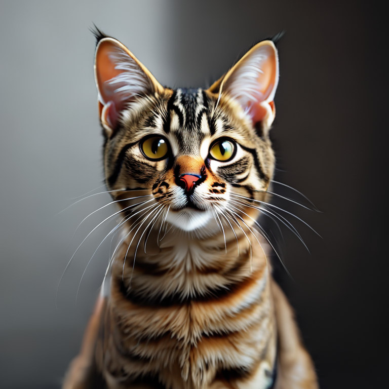
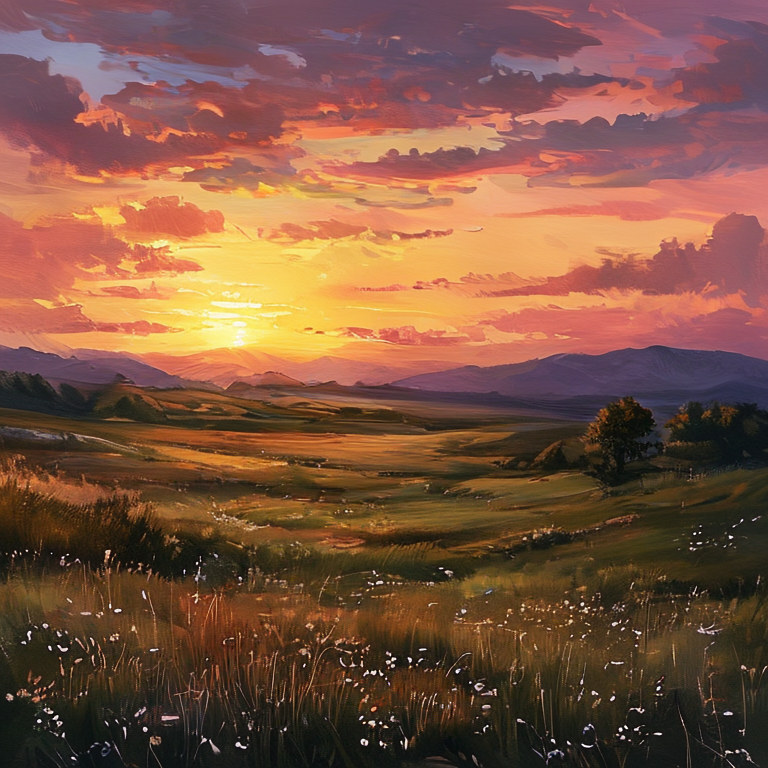

# Encrypted text to image

Gemma-2-2B and SANA-Sprint 0.6B turn a text prompt into a 768 × 768 image fully encrypted, in 269 s on one
GPU. Both images below were generated this way.

<p align="center">
  
  
</p>

```bash
perseus-t2i "a photo of a cat"
perseus-t2i "a landscape at the sunset"
```
